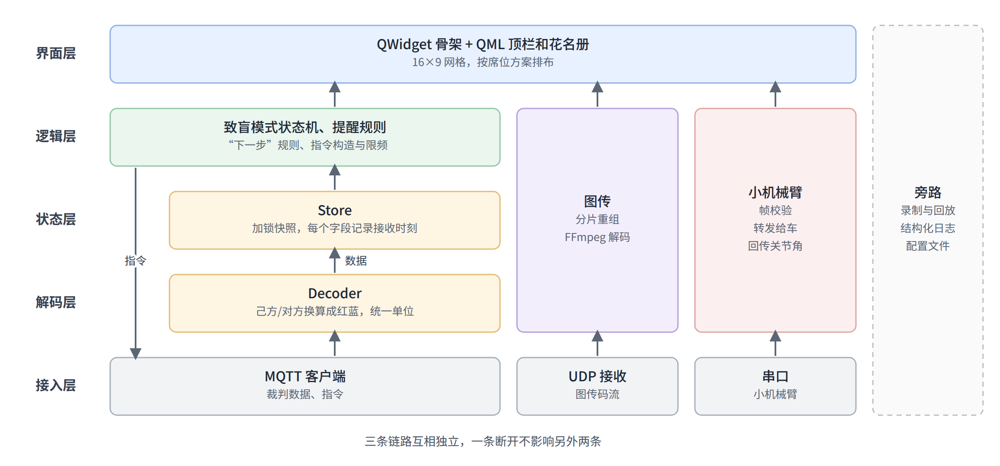
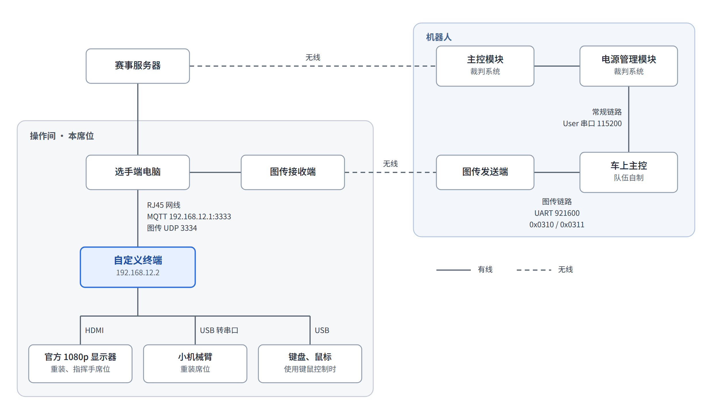

### 3.2.1.1 战术定位分析

        操作手比赛时主要看官方选手端，终端是旁边的第二块屏，要做的是选手端做不到、操作手顾不上的事。选手端做不到的，例如：对方飞镖命中我方前哨站或基地后，选手端界面会被遮挡，终端仍能收到图传；本车通过 0x0310 发来的数据也只有终端能用，雷达解析出的对方经济和发弹量，就可以先发给本车，再由本车转给终端。操作手顾不上的，是比赛中没空一直盯着的信息，以及忙中容易点错的指令；终端把信息集中到一屏，出现关键变化或到了关键时间点就主动提醒，发指令时防误点。分析时先读规则和通信协议，弄清终端能收发什么、接在哪里、受哪些限制，再找出比赛中操作手看不到画面、来不及反应、记不住时间点或点错指令的情况，逐条和选手端对照。队内整理的痛点也是分析的依据：不知道对方还剩多少弹丸，无意中放跑对方残血车，被对方飞镖致盲时没有画面，赛后缺少复盘材料。

**（1）影响定位的规则条款**

| 条款                          | 规则内容（摘要）                                                                                                                                                                                                                                                                                                                                | 对终端定位的影响                                                                                                                 |
| ----------------------------- | ----------------------------------------------------------------------------------------------------------------------------------------------------------------------------------------------------------------------------------------------------------------------------------------------------------------------------------------------- | -------------------------------------------------------------------------------------------------------------------------------- |
| 5.7.3 飞镖命中收益            | 第 1–4 次命中前哨站、基地固定目标或随机固定目标时，对方所有操作手界面、小地图中的机器人位置、自定义 UI 分别被遮挡 10、5、3、2 秒；命中随机移动或末端移动目标时遮挡 10 秒，连续命中时遮挡时间叠加。遮挡期间操作手可以选择在选手端的大地图上点击，以半自动方式控制机器人（两次间隔不短于 3 秒）；规则写明"自定义终端仍可以正常接受图传画面等数据" | 遮挡期间选手端看不到图传，终端仍能接收。终端在这段时间切成全屏图传，让操作手继续看着画面驾驶                                     |
| 5.6.1 后勤系数                | λ = 1 − Δ/20000（Δ 为己方基地已损失血量）；图传分辨率按 x·λ² 降低，且"包含官方选手端与自定义终端的图传画面"                                                                                                                                                                                                                                     | 基地掉血后终端画面同样变糊；可由车端通过 0x0310 上传自瞄框和目标编号，叠加在终端的图传上，帮助操作手在画面变糊时认出目标         |
| 5.6.2、5.8                    | 阵地分临时控制和完全控制；同时控制 2 个前哨阵地，控制度每秒 +1，同时控制 2 个基地阵地，每秒 +3；一局时间耗尽且双方基地均未被击毁时，累计控制度高者获胜                                                                                                                                                                                          | 阵地和控制度是胜负主线，要持续显示，并在易手和落后时提醒                                                                         |
| 5.6.4.9 堡垒                  | 比赛进行 3 分钟且对方前哨阵地被己方控制后，可以激活对方堡垒，单次激活计满 10 秒，对方基地护甲展开                                                                                                                                                                                                                                               | 敌方开始激活我方堡垒时必须立刻提醒                                                                                               |
| 5.6.3、5.4.2                  | 小能量机关在开赛和 1:30、大能量机关在 3:00、4:15、5:30 各给 1 次机会，由步兵操作手通过选手端触发，进入正在激活状态后 20 秒内未被激活即恢复为未激活；脱战（连续 6 秒未发射且未被扣血）时可远程兑换 17mm 100 发或 42mm 10 发，6 秒后生效                                                                                                          | 时间点固定，适合倒计时提醒；触发、兑换这类操作可以放在终端上直接操作                                                             |
| 5.4.3 能量单元装配            | 重装要依次完成插入 100 mm、上移 100 mm、绕 P 轴转 90°、绕 Q 轴转到指定角度并停留 0.3–0.5 秒，再确认装配                                                                                                                                                                                                                                         | 精细操作适合用小机械臂（原自定义控制器）主从控制；2027 赛季控制器数据只能经终端以 0x0311 发给车                                  |
| 表 3-10、5.7.4 雷达解析电磁波 | 双方雷达基座放置官方发射源，信息波包含对方各机器人位置、血量、剩余发弹量、增益，以及队伍剩余经济和总经济；队伍要在雷达上自制天线和解调电路才能解析；雷达可以向所有己方机器人发送数据                                                                                                                                                            | 协议发给终端的经济只有己方，对方的剩余金币和发弹量只能来自雷达解析，再由车端转发给终端。这条链路依赖雷达组，排在最后做，但必须做 |
| 通信协议 1.1、1.4.1、第 2 章  | MQTT + Protobuf，服务器 192.168.12.1:3333，终端固定 192.168.12.2，clientID 填所连机器人 ID；图传走 UDP 3334，1920×1080、60 帧、HEVC、无重传；0x0311 终端→车不超过 60 字节、75 Hz，0x0310 车→终端不超过 300 字节、50 Hz；键鼠指令 75 Hz，来源在选手端和终端中二选一；裁判系统数据延迟约 130 ms，网络恶劣时约 200 ms、丢包约 3%                   | 决定了软件架构；每条链路都要能容忍丢包和断线                                                                                     |

**（2）角色与各时段任务**

本项目的定位：每个操作手席位上的第二块屏和指令台，重装席位上还负责转发小机械臂的控制数据。它属于附属设备，对比赛的作用体现在：

- 多看到：显示车端经 0x0310 发来的数据，例如雷达解析出的对方经济和发弹量；官方选手端本身不显示这些数据。
- 少分心：把裁判数据整理成一屏态势，关键变化用横幅和语音主动提醒，操作手少花精力自己去找。
- 不断档：被对方飞镖致盲时自动切成全屏图传；任何一条链路出问题，能直接看出是哪一条。

此外，终端全程录下裁判数据和图传，供赛后复盘。

各席位分工如下：

| 席位                    | 在队伍中的角色          | 终端的专属任务                                                                                       |
| ----------------------- | ----------------------- | ---------------------------------------------------------------------------------------------------- |
| 重装（1 / 101）         | 装配能量单元、42mm 火力 | 装配面板（选难度、步骤进度、装配结果）；小机械臂主从控制转发；42mm 发射机构状态；接官方 1080p 显示器 |
| 步兵（3、4 / 103、104） | 主要输出、激活能量机关  | 赛前选性能体系；赛中触发能量机关，兑换和远程兑换发弹量、血量，复活；终端自带屏幕                     |
| 指挥手（6 / 106）       | 全局调度                | 飞镖闸门与目标；哨兵控制方式与干预；向队友下发地图标记；接官方 1080p 显示器                          |

各时段任务如下：

| 时段                   | 终端的主要任务                                                                                                                                                                                                                                   |
| ---------------------- | ------------------------------------------------------------------------------------------------------------------------------------------------------------------------------------------------------------------------------------------------ |
| 赛前（检录、候场）     | 通过检录；按"操作手 + 席位"加载界面方案；离线语音预先合成                                                                                                                                                                                        |
| 三分钟准备阶段         | 选席位，以车号登录服务器；自检页核对席位和四条链路（裁判、车端、图传、控制器）以及录像、语音，全部正常时显示"全部正常"，有异常时写明是哪几项；步兵选性能体系；指挥手在 15 秒自检前选哨兵控制方式；发现故障时在 15 秒倒计时前决定是否申请技术暂停 |
| 十五秒自检、五秒倒计时 | 五秒倒计时开始时自检页自动关闭；七分钟比赛阶段开始后界面设置锁定，本局结束后解锁                                                                                                                                                                 |
| 开赛至 3:00            | 小能量机关（开赛、1:30）提醒和触发；开赛 30 秒起双方都可开闸：我方指挥手先选目标再开闸，对方开闸时（Event 10）地面席位收到"敌方闸门已开，注意致盲"提醒；我方被命中后自动全屏图传，遮挡结束 3 秒后切回；前哨阵地易手、控制度落后提醒              |
| 3:00 至 5:30           | 大能量机关（3:00、4:15、5:30）提醒和触发；敌方激活我方堡垒时告警；第二次闸门机会（4:00）；脱战时提示可以远程兑换；阵亡后金币复活或确认免费复活                                                                                                   |
| 5:30 至 7:00           | 基地都未被击毁时胜负看控制度：顶栏持续显示双方控制度差，落后超过阈值时提醒；敌方残血（不超过 25%）高亮并语音提醒，避免放跑                                                                                                                       |
| 全程（雷达解析成功后） | 显示雷达解析出的对方剩余金币和各车允许发弹量，判断对方火力还能维持多久                                                                                                                                                                           |
| 局间、赛后             | 显示结算；录像持续保存；赛后用录像回放和复盘报告总结                                                                                                                                                                                             |

**（3）定位对应的关键能力**

以下能力是 3.2.1.2 功能清单的依据，也就是功能清单中的 L1 需求。

| 能力       | 要做到什么                                                                                       |
| ---------- | ------------------------------------------------------------------------------------------------ |
| 可信接入   | 按席位登录；完整解析 2027 协议；逐字段判断数据是新鲜、过期还是从未收到                           |
| 图传保底   | 稳定接收并解码 1080p60 图传；我方被对方飞镖命中时自动切成全屏                                    |
| 态势呈现   | 按席位在一屏内呈现双方血量、阵地、控制度、经济、事件和地图                                       |
| 主动提醒   | 在阵地易手、控制度落后、堡垒被激活、时间窗口到来、敌方残血等时刻用横幅和语音提醒                 |
| 安全发令   | 本车、重装、指挥手指令在终端上直接发出；限频、防误触、断线不补发、有回执                         |
| 车端联动   | 小机械臂双向转发；接收车端经 0x0310 发来的数据，自瞄框叠加到图传，雷达情报显示在面板上；键鼠控制 |
| 可靠可诊断 | 各条链路互不影响、自动恢复；上场前一屏自检；日志可追查                                           |
| 记录复盘   | 整场默认录制，可回放，可生成复盘报告                                                             |

### 3.2.1.2 需求分析与功能清单

**（1）由战术定位推导能力和功能**

| 场景                                     | 操作手遇到的问题                 | 需要的能力         | 主要功能                         |
| ---------------------------------------- | -------------------------------- | ------------------ | -------------------------------- |
| 对方飞镖命中，选手端被遮挡               | 2–10 秒看不到图传画面            | 图传保底           | 致盲时自动切全屏、图传接收与显示 |
| 基地掉血后图传降质                       | 远处装甲板、编号看不清           | 车端联动           | 车端数据叠加                     |
| 阵地易手、控制度决定胜负                 | 驾驶时顾不上看阵地和控制度       | 态势呈现、主动提醒 | 一屏态势、战场事件提醒           |
| 堡垒被激活 10 秒即破甲                   | 发现晚了来不及回防               | 主动提醒           | 战场事件提醒                     |
| 能量机关、闸门时间点固定                 | 容易错过窗口，或被致盲时没有准备 | 主动提醒、安全发令 | 战场事件提醒、本车指令           |
| 队内痛点：放跑对方残血车、赛后缺复盘材料 | 机会流失，问题难以总结           | 主动提醒、记录复盘 | 战场事件提醒、录制回放、复盘报告 |
| 队内痛点：不知道对方还剩多少弹丸和金币   | 无法判断对方火力还能维持多久     | 态势呈现、车端联动 | 雷达情报显示                     |

**（2）功能清单**

功能清单分三层：

- L1 需求：由战术定位推出、终端必须满足的需求，即 3.2.1.1 中的关键能力，另加上场要求、开发验证两项任务。每条 L1 写明对比赛的价值和整体验收指标，由哪些 L2 共同满足，各 L2 的负责人和交付时间；全部 L2 准出后，用整场演练和官方联调验收。
- L2 功能：解决某条 L1 中一部分场景的功能。每个 L2 写明它解决 L1 的哪一部分、针对什么场景，由哪些 L3 组成、各 L3 的负责人，以及开发、联调、验收的时间线；自测重点放在 L3 之间衔接的地方，检查有没有互相阻塞；准出前按自查表逐项确认每个 L3 都已完成。
- L3 技术特性：实现 L2 的单个技术模块。每个 L3 写明需求价值和量化验收指标；详细设计，包括模块框图、流程图、关键数据结构和接口定义；后续复用和定制的方式；调试手段，包括故障自诊断和常见异常信息；稳定性评估和测试计划；功能、性能、异常、稳定性四类自测用例；开发工作量、交付记录和方案变更记录。

下面按技术方向列出 L2 功能，每个 L2 注明对应的 L1 和包含的 L3。

通信与数据

| L2 功能        | 对应 L1  | L3 技术特性                                              | 验收标准                                                                  |
| -------------- | -------- | -------------------------------------------------------- | ------------------------------------------------------------------------- |
| 接入赛事服务器 | 可信接入 | 席位登录与重连、协议解析、逐字段新鲜度、后勤系数等推算值 | 席位选错时标红；拔网线 2 s 内报警，插回自动恢复；红、蓝席位逐字段测试通过 |

图传

| L2 功能          | 对应 L1  | L3 技术特性                                         | 验收标准                                                                     |
| ---------------- | -------- | --------------------------------------------------- | ---------------------------------------------------------------------------- |
| 图传接收与显示   | 图传保底 | 分片重组、HEVC 解码、解码器自恢复、全屏全分辨率显示 | 2% 丢包时画面不中断；全屏 1080p 不低于 55 帧/s；比选手端画面滞后不超过 50 ms |
| 致盲时自动切全屏 | 图传保底 | 遮挡时间推算、模式切换                              | 遮挡时长符合规则 5.7.3；收到命中事件后 250 ms 内切全屏；遮挡结束 3 s 后切回  |

界面显示

| L2 功能        | 对应 L1  | L3 技术特性                                      | 验收标准                                                                     |
| -------------- | -------- | ------------------------------------------------ | ---------------------------------------------------------------------------- |
| 按席位切换界面 | 态势呈现 | 选席位页、三种席位布局                           | 1280×760 到 1920×1080 布局正常；重装、指挥手在官方显示器上全屏               |
| 一屏态势       | 态势呈现 | 顶栏、花名册、战术地图、事件时间轴、战场数据分析 | 数值与服务器数据一致，缺失显示"--"；地图换成 2027 场地，坐标误差不超过 0.3 m |
| 界面方案编辑   | 态势呈现 | 拖拽编辑、多套方案、按操作手和席位保存           | 编辑后布局没有空缺；比赛中不能修改                                           |

提醒与辅助决策

| L2 功能        | 对应 L1  | L3 技术特性                                                              | 验收标准                                                          |
| -------------- | -------- | ------------------------------------------------------------------------ | ----------------------------------------------------------------- |
| 战场事件提醒   | 主动提醒 | 阵地、控制度、敌方残血、堡垒、基地受击、能量机关、闸门等提醒；横幅加语音 | 每种提醒触发次数正确；敌方开闸后 0.5 s 内提醒；操作间噪声下听得清 |
| 战术倒计时提醒 | 主动提醒 | 赛前录入、到点播报                                                       | 到点播报两遍；比赛中不能修改                                      |
| "下一步"建议卡 | 主动提醒 | 按规则排序，显示最该做的三件事                                           | 阈值经操作手试用后确定                                            |

指令发送

| L2 功能      | 对应 L1  | L3 技术特性                                  | 验收标准                                                       |
| ------------ | -------- | -------------------------------------------- | -------------------------------------------------------------- |
| 指令发送保护 | 安全发令 | 限频、断线丢弃、按住确认、回执检查           | 每类不超过 10 Hz；断线期间的点击不补发；2 s 无回执提示"未确认" |
| 本车指令     | 安全发令 | 性能体系、兑换和远程兑换、复活、开能量机关   | 编码逐字段测试通过；联调时服务器接受                           |
| 重装装配     | 安全发令 | 选难度、确认装配、取消装配                   | 显示装配结果和失败原因                                         |
| 指挥手飞镖   | 安全发令 | 闸门状态、选目标、开闸、发射                 | 发射要按住 1 s；状态以服务器回读为准                           |
| 指挥手哨兵   | 安全发令 | 赛前选控制方式；赛中切姿态、买弹、回血、复活 | 每次操作有回执；冷却期内不能切姿态                             |
| 地图标记     | 安全发令 | 指挥手点击下发、各席位显示                   | 发送间隔不小于 0.5 s；标记保留 30 s                            |

控制器与车端联动

| L2 功能          | 对应 L1            | L3 技术特性                    | 验收标准                                        |
| ---------------- | ------------------ | ------------------------------ | ----------------------------------------------- |
| 小机械臂主从控制 | 车端联动           | 控制数据转发给车、车端姿态回传 | 不超过 75 Hz，不补发旧帧；拔线后车端 1 s 内停住 |
| 键鼠控制         | 车端联动           | 接管键鼠，按 75 Hz 发送        | 按 Esc、失焦或断线即退出，退出时松开全部按键    |
| 车端数据叠加     | 车端联动           | 约定 0x0310 布局、自瞄框叠加   | 叠加框与画面相差不超过 2 帧；数据过期即变灰     |
| 雷达情报显示     | 态势呈现、车端联动 | 雷达发送、车端转发、终端显示   | 显示对方金币和发弹量并标注时效；延迟不超过 1 s  |

可靠性保障

| L2 功能        | 对应 L1              | L3 技术特性                                  | 验收标准                                                                             |
| -------------- | -------------------- | -------------------------------------------- | ------------------------------------------------------------------------------------ |
| 链路状态与自检 | 可靠可诊断           | 四条链路状态灯、上场前自检页、码率和抖动统计 | 断开哪条只有哪条报警，恢复后自动变绿；全部正常时显示"全部正常"，有异常时写明是哪几项 |
| 运行保障       | 可靠可诊断、记录复盘 | 单调时钟、配置检查、结构化日志、断电保护     | 配置写错时指出行号；断电后录像仍能回放                                               |

记录与复盘

| L2 功能  | 对应 L1  | L3 技术特性                            | 验收标准                                |
| -------- | -------- | -------------------------------------- | --------------------------------------- |
| 录制回放 | 记录复盘 | 自动录制、变速和拖动回放               | 无需手动开启；回放与实况一致            |
| 复盘报告 | 记录复盘 | 曲线和关键事件报告、自动切片、多局对比 | 每局结束后 1 min 内生成；数值与回放一致 |

硬件与部署

| L2 功能  | 对应 L1  | L3 技术特性                  | 验收标准                                                      |
| -------- | -------- | ---------------------------- | ------------------------------------------------------------- |
| 比赛终端 | 上场要求 | 硬件定型、电池供电、合规配置 | 通过检录；电池满负荷连续工作不少于 90 min；配置由脚本自动完成 |
| 终端组网 | 态势呈现 | 第二网口组网、标记同步       | 组网断开不影响各终端单独工作                                  |

测试工具

| L2 功能      | 对应 L1  | L3 技术特性                      | 验收标准                                                       |
| ------------ | -------- | -------------------------------- | -------------------------------------------------------------- |
| 模拟器与测试 | 开发验证 | 规则模拟器、故障注入、自动化测试 | 8 个席位协议测试通过；每种故障都能注入和恢复；每次推送自动测试 |

**（3）排序及理由**

L2 功能按以下顺序推进：

1. 比赛终端、模拟器与测试：不合规就不能上场；后面每个功能都要用模拟器测试。
2. 接入赛事服务器、图传接收与显示、致盲时自动切全屏、按席位切换界面、链路状态与自检、指令发送保护：规则 5.7.3 写明遮挡期间终端仍能接收图传，这是选手端做不到的，本项目把它作为首要任务；其余功能都建立在数据接入、链路和发送保护之上。
3. 一屏态势、战场事件提醒、本车指令、重装装配、指挥手飞镖、指挥手哨兵、地图标记、小机械臂主从控制、录制回放、运行保障：每局都要用，直接对应控制度、阵地、堡垒、能量机关、飞镖这些胜负主线；除小机械臂外都不依赖其他组，可以先在模拟器上验证。
4. 车端数据叠加、键鼠控制、复盘报告、"下一步"建议卡、界面方案编辑、战术倒计时提醒：收益明确，但要么依赖车端配合，要么需要真实比赛数据或操作手试用来调整。
5. 雷达情报显示、终端组网：雷达情报确定要做，它是终端拿到对方经济和发弹量的唯一途径，但要等雷达组能稳定解调信息波、车端在 0x0310 里留出位置后才能联调，所以排在最后；组网要等答疑结论，有余力再做。复盘报告中的自动切片和多局对比也排在最后，要等报告本身完成。

开发顺序与上面不完全一致：模拟器、链路状态和录制最先做，因为后面每个功能都要用模拟器测、靠链路灯排障；录制只保存原始数据，不依赖协议，越早开始，做复盘报告时可用的真实数据就越多。

**（4）整体完成标准**

- 一场模拟 BO3 全程无崩溃、无卡死，每局准备阶段内自检页都显示"全部正常"；
- 排序中前三组的 L2 功能达到各自的验收标准，并通过准出前自查；自动化测试和验收脚本全部通过；
- 与官方赛事引擎完成联调，核对清单全部确认；
- 每个席位的操作手实机试用后确认看得清、点得准。

### 3.2.1.3 技术方案设计

**（1）总体方案**

终端软件用 C++17 和 Qt6 编写，结构如下图：裁判数据逐层处理后送到界面，图传和小机械臂各走一条独立的链路。

赛场上终端只用一根网线接本席位的选手端电脑，其余设备都接在终端上。按通信协议，裁判数据和指令走 MQTT，图传码流走 UDP；车端的 0x0310、0x0311 在终端上对应 MQTT 的 CustomByteBlock 和 CustomControl，由选手端经图传链路转发。

**（2）各项功能的实现方式**

| 技术方向         | 实现方式                                                                                                                                                                                       |
| ---------------- | ---------------------------------------------------------------------------------------------------------------------------------------------------------------------------------------------- |
| 通信与数据       | 用 libmosquitto 连 MQTT，clientID 填席位车号；Protobuf 解码后每个字段记录接收时刻，超过 2.2 s 判为过期                                                                                         |
| 图传             | 按 8 字节包头重组分片，FFmpeg 子进程解码，卡住或退出时自动重启；收到对方飞镖命中事件后按规则推算遮挡时间，自动切全屏                                                                           |
| 界面显示         | 信息页按 16×9 网格排布，方案按"操作手 + 席位"保存；顶栏和花名册用 QML                                                                                                                          |
| 提醒与辅助决策   | 每次快照与上一次比较，按规则表产生提醒并去重；语音赛前合成，赛中只播放                                                                                                                         |
| 指令发送         | 每类指令一个发送器，统一限频、断线丢弃、等待回执；不可撤回的操作要按住 1 s                                                                                                                     |
| 控制器与车端联动 | 小机械臂的串口帧校验后转成 CustomControl，关节角从 CustomByteBlock 取出写回；车端叠加和雷达情报计划与车端约定 0x0310 布局，雷达经 0x0301 把情报发给己方地面车，每台约 80 字节/秒，低于接收额度 |
| 可靠性保障       | 四条链路各有判定规则，状态灯和自检页用同一份结果；全进程使用单调时钟                                                                                                                           |
| 记录与复盘       | 在入口处录下原始字节和时间戳，回放走同一套解码；复盘报告计划离线读取录像生成                                                                                                                   |
| 硬件与部署       | 计划用部署脚本设置静态 IP，关闭无线和休眠                                                                                                                                                      |
| 测试工具         | Python 模拟器按 2027 规则发消息、回应指令；链路代理和假机械臂注入故障                                                                                                                          |

**（3）核心硬件选型**

比赛机选笔记本，装 Ubuntu 26.04：内置电池满足规则 R15 的自带电源要求，内置屏解决步兵席位没有官方显示器的问题。具体型号待定，关键参数如下：

| 项目     | 功能要求                                    | 选型要求                     | 能否满足                                                                             |
| -------- | ------------------------------------------- | ---------------------------- | ------------------------------------------------------------------------------------ |
| 图传解码 | 实时解码 1080p60 HEVC 图传                  | 不低于 i5-13500H，16 GB 内存 | 开发机上实测每秒约解码 205 帧，是图传帧率的 3 倍多；用的是合成画面，要用真实图传复测 |
| 供电     | 自带电源                                    | 电池 60 Wh 以上              | 待实测连续工作 90 min                                                                |
| 显示     | 步兵自带屏；重装、指挥手接官方 1080p 显示器 | 15.6 英寸 1080p 屏、HDMI     | 满足                                                                                 |
| 网口     | 只接 1 根赛事网线                           | RJ45 1GbE                    | 满足；图传按 20 Mbps 估算，约占 2%                                                   |
| 外设     | 接小机械臂串口和键鼠                        | 至少 2 个 USB-A              | 满足；串口最高约占波特率的 23%                                                       |
| 存储     | 整局录制                                    | 512 GB SSD                   | 满足；按图传码率估算每局 0.4–0.8 GB                                                  |

**（4）备选方案与选择理由**

| 方面     | 当前方案              | 备选方案                                             | 选择理由                                                                                   |
| -------- | --------------------- | ---------------------------------------------------- | ------------------------------------------------------------------------------------------ |
| 运算平台 | 笔记本                | 迷你主机加移动电源和便携屏；带网口的平板；ARM 开发板 | 笔记本自带电池和屏，接线最少；平板多用低功耗 CPU，ARM 板要适配厂商的解码库                 |
| 界面框架 | C++17 + Qt6           | Python + PySide6；Web/Electron                       | Qt 同时提供界面、网络和子进程管理，C++ 处理图传帧开销小；早期 Python 原型已由 C++ 版本取代 |
| 图传解码 | FFmpeg 子进程软件解码 | 进程内解码；硬件解码                                 | 子进程崩溃不影响界面，可自动重启；不依赖显卡驱动；实测速度有余量                           |
| 全屏显示 | 计划改为 GPU 缩放显示 | 全分辨率 BGR24 + QPainter                            | GPU 显示不用在 CPU 上逐帧转换和缩放 1080p 画面；QPainter 改动最小，作为保底                |
| 致盲切换 | 按命中事件自动切换    | 操作手手动切换                                       | 比赛中操作手顾不上按按钮；点击缩略图仍可手动展开                                           |
| 测试环境 | 自研 2027 规则模拟器  | 只用官方赛事引擎                                     | 官方引擎和真车联调机会少，也不能注入断线、坏帧等故障                                       |

### 3.2.1.4 可行性与风险分析

**（1）实现条件**

| 方面 | 判断     | 依据                                                                                                                                                                                                                                                                                                                                                                                                                                                                                                                                         |
| ---- | -------- | -------------------------------------------------------------------------------------------------------------------------------------------------------------------------------------------------------------------------------------------------------------------------------------------------------------------------------------------------------------------------------------------------------------------------------------------------------------------------------------------------------------------------------------------- |
| 技术 | 基本具备 | 已在模拟器上完成 2027 协议接入、三种席位界面、提醒、指令、机械臂转发的终端侧、键鼠控制、录制回放和链路保障，都还没和官方服务器、真车联调；代码规模按非空行计：C++ 约 3.3 万行，其中测试约 0.9 万行；QML 约 1,900 行；模拟器 Python 约 4,700 行；验收脚本约 1,400 行。还没做的有：全屏全分辨率显示、2027 场地底图、敌方闸门开启提醒、哨兵控制方式选择、码率和抖动统计、车端数据叠加、雷达情报显示、复盘报告、比赛终端和部署脚本、终端组网。这些都有现成的库或做法，预计不需要新算法，难点在性能调优和联调；雷达情报的难点在雷达组的信息波解调 |
| 性能 | 基本具备 | i5-13500H 上用合成测试流实测，全分辨率软件解码每秒约 205 帧，是图传帧率的 3 倍多；显示环节和真实图传还没测                                                                                                                                                                                                                                                                                                                                                                                                                                   |
| 人员 | 基本具备 | 软件由一人负责，大部分功能已完成；车端、雷达配合人员和后备开发者还要落实，见 3.2.1.5                                                                                                                                                                                                                                                                                                                                                                                                                                                         |
| 时间 | 基本具备 | 规则和通信协议都已发布，终端已按新协议完成迁移；剩余开发和联调的时间安排见本节测试验证安排和 3.2.1.5                                                                                                                                                                                                                                                                                                                                                                                                                                         |
| 经费 | 具备     | 主要是比赛终端硬件，估算 1.5–1.95 万元；软件全部使用开源库，没有授权费用                                                                                                                                                                                                                                                                                                                                                                                                                                                                     |

**（2）尚未验证的关键环节**

1. 官方赛事引擎：还没联调；协议中有 6 处细节没写明，如雷达消息的字段号、鼠标值的单位；指挥手终端能否发送哨兵控制方式也要确认。
2. 真实图传：码率、丢包时的表现和基地掉血后的画质未知；致盲期间雷达位置是否照常下发不确定。
3. 全屏全分辨率显示还没做：现在全屏时只是每秒约 4 帧的低分辨率放大画面。
4. 硬件：比赛机在电池供电下的性能、续航和驱动兼容性还没测。
5. 车端：重装还没在真车上实现 0x0311 解析和 0x0310 回传；图传链路没有重传，真实延迟和丢包未知。
6. 可用性：字号、按钮大小、语音可听度和"下一步"建议卡的阈值，都还没经操作手实测。
7. 雷达情报：要靠雷达组解调信息波，能否稳定解出未知；数据经雷达到车、车到终端两次转发，延迟未知。

**（3）主要风险与应对**

| 风险                                       | 可能性 | 影响                                         | 应对与备选                                                                                                                               |
| ------------------------------------------ | ------ | -------------------------------------------- | ---------------------------------------------------------------------------------------------------------------------------------------- |
| 比赛机续航不足或驱动不兼容                 | 中     | 比赛中断电，或根本无法使用                   | 做 90 min 满负荷续航和驱动测试；关闭休眠；自检页增加电量一项，低于 30% 标"注意"                                                          |
| 车端配合不到位                             | 高     | 机械臂和叠加功能无法落地                     | 写出 0x0310/0x0311 字节布局文档，与电控组评审；终端侧已有假机械臂和模拟车端，车端照文档实现即可；车端叠加排在后面做，延期不影响其他功能  |
| 雷达解调不稳定，雷达情报没有数据或数据太旧 | 中     | 终端看不到对方经济和发弹量，这个痛点没有解决 | 终端给每个数值标注时效，没有数据时显示"未解析"，不影响其他功能；终端侧先用模拟器做完，雷达一就绪即可联调；备选为雷达直接在选手端绘制文字 |
| 语音在操作间听不清，或不允许配耳机         | 中     | 提醒只剩视觉                                 | 提醒以横幅为主、语音为辅；提交答疑；用赛场噪声录音实测                                                                                   |

**（4）测试验证安排**

项目已进入软件测试阶段。已完成的测试都在 Ubuntu 26.04 上用模拟器和故障注入完成；测试完成后界面又有改动，需要重跑。

已完成的测试：

| 测试                   | 测试条件                                                                           | 通过标准                                                                                    | 结果                                                                  |
| ---------------------- | ---------------------------------------------------------------------------------- | ------------------------------------------------------------------------------------------- | --------------------------------------------------------------------- |
| 单元和组件测试         | Release 构建，不开窗口运行                                                         | 全部通过                                                                                    | 35 个测试全部通过                                                     |
| 致盲模式切换端到端回归 | 起模拟器、图传发送端和终端；模拟器在比赛第 30 s 让敌方飞镖命中我方基地随机移动目标 | 只切换 2 次：进全屏一次、切回一次；全屏保持时间等于 10 s 遮挡加 3 s 防抖                    | 通过：只切换了 2 次，全屏保持约 13 s                                  |
| 链路故障验收           | 逐条断开裁判、车端、图传、机械臂；发送坏帧；四条同时断开                           | 对应的灯在时限内变红，其他灯不受影响，恢复后自动变绿；拔机械臂后车端 1 s 内停住；终端不崩溃 | 35 项检查全部通过                                                     |
| 事件提醒验收           | 模拟器把每种事件演一遍                                                             | 每种提醒的触发次数正确                                                                      | 18 项检查全部通过                                                     |
| 分席位验收             | 步兵、重装、指挥手各跑一局                                                         | 席位核对、地图标记、飞镖、哨兵、装配、本车指令的结果正确                                    | 46 项检查全部通过                                                     |
| 键鼠控制测试           | 用程序模拟按住 W、移动鼠标 600 像素、单击、滚轮 1 格，再按 Esc                     | 发送频率接近 75 Hz，位移不丢失，退出时发出全部松开                                          | 通过：频率约 73 Hz；发出的位移合计正好 600 像素；退出时发出了全部松开 |
| 解码性能测试           | 开发机，1080p60 HEVC 合成测试流                                                    | 每秒解码帧数不低于图传帧率的 2 倍                                                           | 每秒约 167–205 帧，约为图传 60 帧/秒的 3 倍                           |

计划开展的测试：

| 测试               | 测试条件                                                                         | 通过标准                                                                                             | 时间                                               |
| ------------------ | -------------------------------------------------------------------------------- | ---------------------------------------------------------------------------------------------------- | -------------------------------------------------- |
| 全屏全分辨率图传   | 1080p60 测试流和真实图传录像，1920×1080 全屏                                     | 不低于 55 帧/s；连续 30 min 不掉帧、内存不增长；高速摄像同时拍选手端和终端，终端画面滞后不超过 50 ms | 1 月初前用测试流测，1 月用真实图传测               |
| 比赛机续航与兼容性 | 电池供电，全屏图传、录制、语音同时运行                                           | 连续工作不少于 90 min，不断电、不降频卡顿；Ubuntu 下网口、HDMI、声卡、串口均正常                     | 1 月                                               |
| 机械臂真车联调     | 小机械臂 + 重装                                                                  | 记录端到端延迟（目标不超过 200 ms）；拔线后 1 s 内车端停住；连续 30 min 没有异常动作                 | 1 月                                               |
| 官方服务器联调     | 校内官方赛事引擎 + 装有裁判系统的真车                                            | 6 处核对项全部确认；所有入站消息显示正确；所有指令被服务器接受并有回执                               | 1 月                                               |
| 可读性与可用性     | 重装、指挥手接 1080p 显示器，步兵用笔记本屏，按座位距离观看；播放赛场噪声        | 操作手确认看得清、点得准、听得到；意见在下一版处理                                                   | 每月                                               |
| 雷达情报链路联调   | 雷达 + 重装、步兵 + 终端；雷达解调就绪前，由雷达程序注入假的 0x0A03、0x0A04 数据 | 终端显示值与雷达解析值一致；端到端延迟不超过 1 s；断开雷达或车端时终端标"过期"，其他功能正常         | 终端侧 1 月初前用模拟器完成；与雷达联调 2 月前完成 |
| 整场演练           | 4 台终端 + 模拟器或官方引擎，打一场 BO3                                          | 全程无崩溃；每局准备阶段内自检页都显示"全部正常"                                                     | 2 月前                                             |
| 适应性训练         | 赛场真实网络                                                                     | 四条链路全部正常；录像完整                                                                           | 区域赛前                                           |

### 3.2.1.5 人力资源安排

**（1）主要工作与负责人**

| 工作           | 内容                                                       | 负责人 |
| -------------- | ---------------------------------------------------------- | ------ |
| 终端软件       | 数据链路、图传、界面、提醒、指令、录制回放、复盘报告       | 郑颖   |
| 模拟器与测试   | 规则模拟器、故障注入、验收脚本、CI                         | 郑颖   |
| 自定义控制器   | 机械结构维护；固件已有（0x0302 上行、0x0309 下行）         | 朱仕彬 |
| 规则跟踪与答疑 | 跟踪规则和协议更新，提交答疑                               | 郑颖   |
| 雷达情报       | 解调信息波，用 0x0301 把对方经济和发弹量发给己方重装和步兵 | 潘锶慧 |

**（2）人员经验与能力基础**

| 人员 | 相关经验与能力基础                                                                           |
| ---- | -------------------------------------------------------------------------------------------- |
| 郑颖 | 有英雄机器人电控经验；本赛季主导本项目，确定需求、方案和界面，各模块经构建、测试、截图后验收 |

**（3）投入程度排序**

郑颖 > 朱仕彬 > 潘锶慧

**（4）时间安排**

| 时间           | 任务                                                                                                                                                                                                                     | 负责人               | 交付物                   |
| -------------- | ------------------------------------------------------------------------------------------------------------------------------------------------------------------------------------------------------------------------ | -------------------- | ------------------------ |
| 现在至 1 月初  | 完善功能：全屏全分辨率图传、2027 场地底图、敌方闸门开启提醒、哨兵控制方式选择、复盘报告、部署脚本；写 0x0310/0x0311 接口文档和雷达 0x0301 消息格式；用模拟器完成车端数据叠加和雷达情报的终端侧；提交答疑；后备开发者上手 | 郑颖                 | 功能完善的版本；接口文档 |
| 1 月           | 接入裁判系统做实物联调：官方赛事引擎、自定义控制器与重装、车端数据叠加、雷达情报；比赛机续航和驱动测试                                                                                                                   | 郑颖、朱仕彬、潘锶慧 | 联调核对表和记录         |
| 2 月前         | 用旧版本赛事引擎把能测试的功能调试好，规避新赛季可能出现的问题                                                                                                                                                           | 全体                 | 演练记录；比赛版本       |
| 2 月后至区域赛 | 只修缺陷；根据答疑结果决定是否做组网；现场排障                                                                                                                                                                           | 郑颖、操作手         | —                        |
